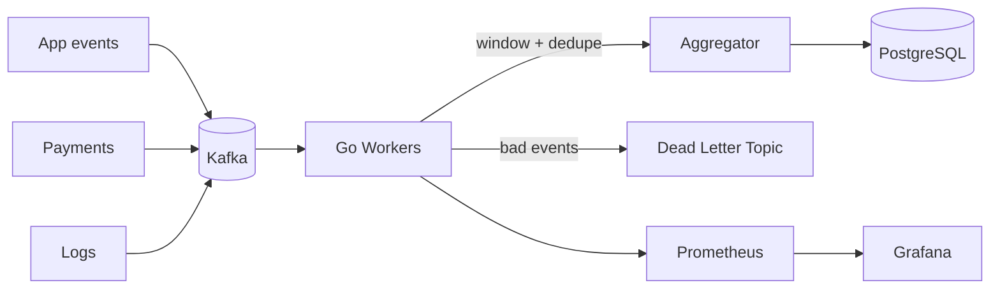

# Real-Time Data Aggregation Engine

**A streaming engine that merges events from many sources into reliable, queryable metrics without losing or double-counting data.**

  

## The Problem

Real products produce events from many places: apps, payments, IoT, logs. Dashboards need up-to-the-second numbers, but streams are messy: events arrive late, out of order, duplicated, or in bursts. Naive pipelines give wrong totals or fall over under load.

## The Idea

A small, focused engine that gets the hard parts right:

- **Event-time windowing** with late-event handling (watermarks)
- **Idempotent writes**, so replays and retries never double-count
- **Backpressure and a dead-letter queue**, so bad data and spikes don't crash the pipeline
- **Built-in load tester**, so every performance claim is reproducible

## Key Features

- Pluggable source connectors (Kafka first, then HTTP and files)
- Tumbling and sliding window aggregations (count, sum, avg, p95)
- Duplicate detection by event ID
- Dead-letter topic for malformed events
- Prometheus metrics and a Grafana dashboard
- Configurable via a single YAML file

## Architecture



## Tech Stack

Go, Apache Kafka, PostgreSQL, Prometheus, Grafana, Docker Compose, GitHub Actions

## Quick Start

```bash
git clone https://github.com/Ghazi1212/realtime-data-aggregation-engine.git
cd realtime-data-aggregation-engine
docker compose up -d                 # Kafka, Postgres, Grafana
go run ./cmd/engine --config config.yaml
go run ./cmd/loadgen --rate 5000     # generate test events
```

Open Grafana at `http://localhost:3000`.

## Reliability Tests

- Kill a worker mid-stream and verify no events are lost
- Replay the same events twice and verify totals do not change
- Send out-of-order events and verify window results are correct

## Benchmarks

| Scenario | Throughput | p95 latency |
|---|---|---|
| Single worker, local machine | TBD | TBD |
| 4 workers, local machine | TBD | TBD |

> Fill in with real results from `cmd/loadgen`. Include your hardware specs.

## Design Decisions

See `/docs/decisions.md` for why I chose event-time windows, Postgres upserts for idempotency, and a dead-letter queue.

## Roadmap

- [x] Kafka consumer with offset management
- [ ] Windowed aggregations
- [ ] Idempotent sink
- [ ] Metrics and dashboard
- [ ] Additional connectors

## License

MIT
